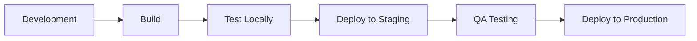

# Deployment Guide

## Overview

The Marine Detail Supply theme uses a custom deployment system that allows you to deploy to individual stores or multiple stores simultaneously.

## Prerequisites

- Theme built (`npm run build`)
- Shopify CLI authenticated
- Store configurations created in `config/stores/`
- Proper access credentials for target stores

## Deployment Commands

### Deploy to Single Store

```bash
npm run deploy -- --store=store-name
```

**Example:**
```bash
npm run deploy -- --store=headquarters
```

### Deploy to All Stores

```bash
npm run deploy -- --all
```

### Deploy Without Building

If assets are already built:
```bash
npm run deploy -- --store=store-name --no-build
```

### Deploy with Auto-Confirmation

Skip the 5-second confirmation delay:
```bash
npm run deploy -- --store=store-name --yes
```

### Combined Options

```bash
npm run deploy -- --all --no-build --yes
```

## Deployment Process

### Step-by-Step

1. **Build Assets**
   ```bash
   npm run build
   ```
   
   This compiles:
   - JavaScript (ESM modules → `assets/global.js`)
   - CSS (Tailwind → `assets/theme.css`)
   - Swiper styles

2. **Verify Build**
   Check that files exist:
   ```bash
   ls -la assets/
   ```
   
   Should include:
   - `global.js`
   - `theme.css`

3. **Test Locally**
   ```bash
   npm run shopify:dev
   ```
   
   Preview changes in Shopify environment before deploying.

4. **Deploy**
   ```bash
   npm run deploy -- --store=your-store
   ```

5. **Verify Deployment**
   - Visit store URL
   - Check theme is active
   - Test functionality

## Deployment Workflow

### Development → Staging → Production



**Step 1: Development**
```bash
git checkout dev
# Make changes
npm run dev
```

**Step 2: Build and Test**
```bash
npm run build
npm run shopify:dev
```

**Step 3: Deploy to Staging**
```bash
npm run deploy -- --store=staging-store
```

**Step 4: QA Testing**
- Manual testing on staging store
- Cross-browser testing
- Mobile device testing

**Step 5: Deploy to Production**
```bash
git checkout main
git merge dev
npm run build
npm run deploy -- --store=headquarters
```

**Step 6: Tag Release**
```bash
git tag -a v1.0.0 -m "Release v1.0.0"
git push origin v1.0.0
```

## Git Workflow

### Branching Strategy

- `main` - Production releases only
- `dev` - Active development
- `feature/*` - Feature branches
- `hotfix/*` - Emergency fixes

### Feature Development

```bash
# Create feature branch
git checkout dev
git checkout -b feature/new-feature

# Make changes
# Commit work

# Merge back to dev
git checkout dev
git merge feature/new-feature

# Test and deploy
npm run build
npm run deploy -- --store=dev-store
```

### Hotfix Process

```bash
# Create hotfix branch from main
git checkout main
git checkout -b hotfix/critical-fix

# Make fix
# Commit changes

# Merge to main
git checkout main
git merge hotfix/critical-fix

# Merge to dev
git checkout dev
git merge hotfix/critical-fix

# Deploy immediately
npm run build
npm run deploy -- --store=headquarters --yes
```

## Version Control

### Tagging Releases

Tag format: `v{major}.{minor}.{patch}`

```bash
# Tag a release
git tag -a v1.2.3 -m "Release version 1.2.3"
git push origin v1.2.3

# List tags
git tag -l

# Checkout specific version
git checkout v1.2.3
```

### Deployment Records

Keep track of deployments:

```bash
# Create deployment log
echo "$(date): Deployed v1.2.3 to headquarters" >> deployments.log
git add deployments.log
git commit -m "Log deployment v1.2.3 to headquarters"
```

## Store Management

### Adding a New Store

1. **Create store directory**
   ```bash
   mkdir -p config/stores/new-store
   ```

2. **Create configuration**
   ```bash
   touch config/stores/new-store/config.json
   ```

3. **Add store details**
   ```json
   {
     "storeName": "new-store",
     "storeUrl": "new-store.myshopify.com",
     "displayName": "New Store",
     "environment": "production"
   }
   ```

4. **Deploy to new store**
   ```bash
   npm run deploy -- --store=new-store
   ```

### Removing a Store

1. **Archive configuration**
   ```bash
   mv config/stores/old-store config/stores/_archived/old-store
   ```

2. **Document removal**
   ```bash
   echo "$(date): Archived old-store" >> store-changes.log
   ```

## Rollback Procedure

### Quick Rollback

If a deployment causes issues:

1. **Checkout previous version**
   ```bash
   git checkout v1.2.2
   ```

2. **Rebuild**
   ```bash
   npm install
   npm run build
   ```

3. **Redeploy**
   ```bash
   npm run deploy -- --store=affected-store --yes
   ```

4. **Return to current branch**
   ```bash
   git checkout main
   ```

### Using Shopify Admin

Alternative rollback method:

1. Go to Shopify Admin → Online Store → Themes
2. Find previous theme version
3. Click "Actions" → "Publish"

## CI/CD Integration

### GitHub Actions Example

Create `.github/workflows/deploy.yml`:

```yaml
name: Deploy Theme

on:
  push:
    tags:
      - 'v*'

jobs:
  deploy:
    runs-on: ubuntu-latest
    steps:
      - uses: actions/checkout@v3
      
      - name: Setup Node.js
        uses: actions/setup-node@v3
        with:
          node-version: '18'
      
      - name: Install dependencies
        run: npm ci
      
      - name: Build theme
        run: npm run build
      
      - name: Deploy to production
        env:
          SHOPIFY_CLI_TOKEN: ${{ secrets.SHOPIFY_CLI_TOKEN }}
        run: npm run deploy -- --store=headquarters --yes
```

### Environment Secrets

Add to GitHub Secrets:
- `SHOPIFY_CLI_TOKEN`
- `SHOPIFY_STORE_URL`
- Any API keys needed

## Monitoring Deployments

### Post-Deployment Checklist

After each deployment:

- [ ] Homepage loads correctly
- [ ] Product pages display properly
- [ ] Cart functionality works
- [ ] Checkout flow is functional
- [ ] Navigation menus work
- [ ] Search functionality works
- [ ] Forms submit correctly
- [ ] Images load properly
- [ ] No console errors
- [ ] Mobile responsive

### Logging

The deploy script logs:
- Build status
- Deployment start/end times
- Success/failure status
- Affected stores

Check logs in terminal output during deployment.

## Troubleshooting

### Authentication Issues

**Problem:** Shopify CLI not authenticated

**Solution:**
```bash
shopify auth logout
shopify auth login
```

### Build Failures

**Problem:** Build fails before deployment

**Solution:**
1. Check for syntax errors
2. Verify all dependencies installed: `npm install`
3. Clear node_modules and reinstall: `rm -rf node_modules && npm install`
4. Check Node.js version: `node --version` (should be 18+)

### Store Not Found

**Problem:** Store configuration not found

**Solution:**
1. Verify store name matches directory: `ls config/stores/`
2. Check `config.json` exists and is valid JSON
3. Ensure `storeUrl` field is present in config

### Permission Denied

**Problem:** No permission to deploy to store

**Solution:**
1. Verify you're logged into correct Shopify account
2. Check you have admin access to the store
3. Confirm store URL is correct in config

### Theme Upload Fails

**Problem:** Theme files won't upload

**Solution:**
1. Check internet connection
2. Verify store URL is correct
3. Check `.shopifyignore` isn't blocking required files
4. Ensure theme size is under Shopify limits

## Best Practices

### Pre-Deployment

1. **Always build first**
   ```bash
   npm run build
   ```

2. **Test locally**
   ```bash
   npm run shopify:dev
   ```

3. **Review changes**
   ```bash
   git diff
   git status
   ```

4. **Create backup**
   - Download current theme via Shopify Admin
   - Or tag current version in Git

### During Deployment

1. **Deploy during low-traffic hours** (if possible)
2. **Monitor for errors** during deployment
3. **Have rollback plan ready**
4. **Communicate with team** about deployment

### Post-Deployment

1. **Verify deployment** immediately
2. **Test critical paths** (cart, checkout, etc.)
3. **Monitor analytics** for anomalies
4. **Document deployment** in logs
5. **Tag release** in Git

### Multi-Store Deployments

1. **Test on one store first**
2. **Deploy to similar stores together**
3. **Stagger deployments** if possible
4. **Have dedicated support available**
5. **Monitor all stores** post-deployment

## Emergency Procedures

### Critical Bug in Production

1. **Identify issue** and severity
2. **Quick fix available?**
   - Yes: Create hotfix branch, fix, deploy immediately
   - No: Rollback to previous version

3. **Hotfix process**
   ```bash
   git checkout -b hotfix/critical
   # Fix issue
   git commit -m "Fix critical issue"
   npm run build
   npm run deploy -- --all --yes
   ```

4. **Document incident**
5. **Post-mortem review**

### Store Outage

1. **Check Shopify status**: https://status.shopify.com
2. **Verify theme is published** in Shopify Admin
3. **Check DNS/domain settings**
4. **Contact Shopify support** if needed

## Support

For deployment issues:
1. Check this documentation
2. Review deployment logs
3. Check Shopify CLI documentation
4. Contact theme administrator

## Appendix

### Useful Commands

```bash
# Build
npm run build

# Deploy single store
npm run deploy -- --store=store-name

# Deploy all stores
npm run deploy -- --all

# Deploy without building
npm run deploy -- --store=store-name --no-build

# Deploy with auto-confirm
npm run deploy -- --store=store-name --yes

# Check theme
npm run shopify:check

# Pull theme from store
npm run shopify:pull

# List Git tags
git tag -l

# Checkout specific version
git checkout v1.0.0
```

### Store URLs

Keep a reference of all store URLs:
- Headquarters: `headquarters.myshopify.com`
- Franchise stores: See `config/stores/` for full list

### Contact Information

- **Theme Administrator**: [contact info]
- **Shopify Support**: https://help.shopify.com
- **Emergency Contact**: [emergency contact]
